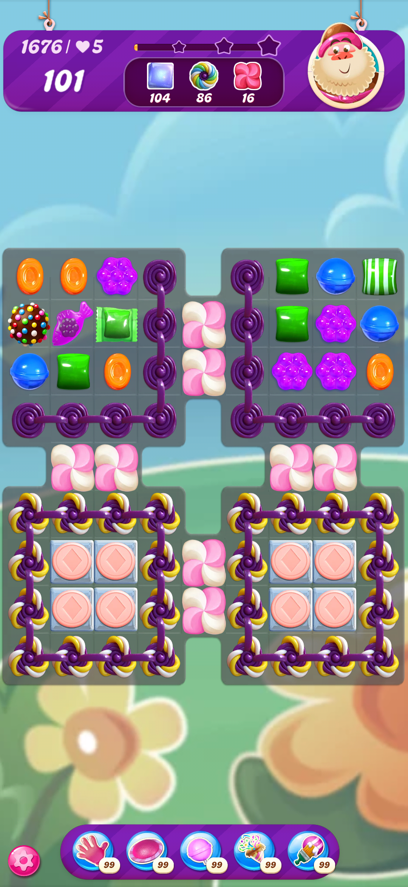
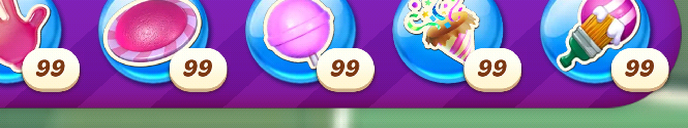
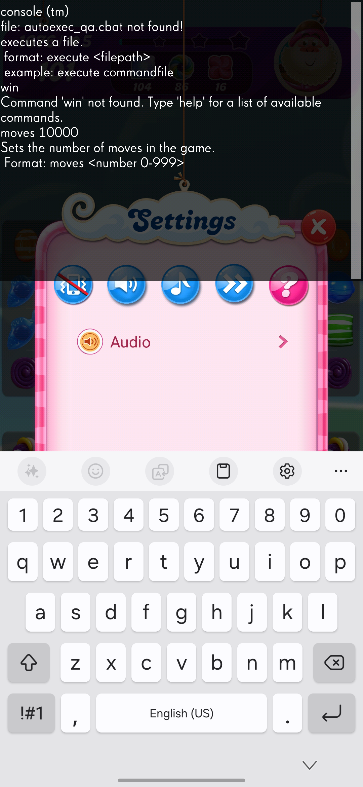

# Candy Crush Saga 1.325.0.1 — arm64 mod

A small set of binary patches for `com.king.candycrushsaga` 1.325.0.1 (versionCode `13250011`) on
Android/arm64. Built by pulling the installed APK, editing eleven instruction sites inside
`lib/arm64-v8a/libcandycrushsaga.so`, repacking, aligning and re-signing.

Everything here is a static patch to the shipped library. No root, no hooking framework, no runtime
instrumentation — the game runs exactly as King ships it apart from the bytes below.

| | |
|---|---|
| Target | `com.king.candycrushsaga` 1.325.0.1 (`13250011`) |
| ABI | arm64-v8a |
| Tested on | Samsung SM-S901W, Android 16 (SDK 36), unrooted |
| Engine | King "Fiction" (native C++), not Unity |
| Library | `libcandycrushsaga.so`, 84,485,416 bytes, `.text` vaddr == file offset |

## What it does

| # | Site | Effect |
|---|------|--------|
| 1 | `0x2a031b4` | moves counter is a constant **101** |
| 2 | `0x1e83a18` | console adapter no longer early-outs in production builds |
| 3 | `0x1e81bf8` | in-level ccsm testing menu gate forced open |
| 4–5 | `0x1f0fc54`, `0x1f0fc5c` | `Debug.DebugViewAvailable` always true |
| 6–9 | `0x1ec9c80`, `0x1e89b60`, `0x1e89c7c` | lives regenerate on a **1 second** interval instead of 30 minutes |
| 10–11 | `0x22fb08c`, `0x288b294` | every booster amount reads **99** and unowned boosters become selectable |
| 12 | `0x2abb69c` | every finished level is scored as a **win** — enter a level and leave again to skip it |

Full instruction-level table with the original bytes and the reasoning is in
[docs/patches.md](docs/patches.md).

## Screenshots

Moves counter pinned at 101 in a live level:



Lives permanently full (`Full`, no timer):


Booster bar — every slot reads 99:



The testing console that patches 2–5 unlock (in-level Settings → Console):



## Build

Requirements: Python 3 with `capstone`, Android SDK build-tools (`zipalign`, `apksigner`), a keystore.

```sh
# 1. get the target library out of the APK you own
unzip -j base.apk lib/arm64-v8a/libcandycrushsaga.so -d .

# 2. patch it (writes build/lib/arm64-v8a/libcandycrushsaga.so)
python tools/mkpatch.py libcandycrushsaga.so

# 3. repack, align, sign
python tools/repackage.py base.apk mod.apk build
zipalign -f -P 16 4 mod.apk mod_a.apk
apksigner sign --ks ~/.android/debug.keystore --ks-pass pass:android \
    --key-pass pass:android --ks-key-alias androiddebugkey --out mod-signed.apk mod_a.apk
```

Then install with `adb install --no-incremental -r -d mod-signed.apk`. `--no-incremental` matters: an
incremental install breaks when the adb host process goes away.

Because the APK is signed with a debug key it cannot install over the Play Store build — uninstall first.
That also means Play Store updates never apply. Progress is cloud-saved on the King account and comes back
on login.

## Verified

* patched `.so` loads and the process image contains all twelve sites (read back with Frida)
* HUD holds 101 moves, boosters read 99 on every slot and in the pre-level menu, lives stay at `Full`
* levels 1596 → 1597 → 1598 were completed by entering and immediately leaving each one
* no magenta/untextured frames with this set (some earlier candidates broke the renderer — see docs)

## Notes and limits

* **Gold bars are not modded.** The HUD number binds to the `User.GoldBarsAmount` data source; the obvious
  economy getters (`0x20f5a28`/`0x20f5a30`) are dormant on the map, and `0x3b15c38`/`0x3b15d54`, which are
  hot, are enum/atlas accessors — patching them to a constant turns the scene magenta.
* Moves `0` does not work: the out-of-moves check runs before a result exists, so the level just fails on
  entry. 101 is shipped.
* The console commands are only reachable from the **in-level** Settings dialog, not from the map's.
* `debuggable` is inherited from the upstream manifest; King's `CMemoryTamperingDetector` does not trip on
  this signature.
* Only arm64-v8a is patched — other ABIs in the APK are untouched and will not carry the mod.

## Disclaimer

Built for personal use from an APK the author owns. Candy Crush Saga is © King. No game assets are
redistributed here — only the patch scripts and screenshots; bring your own `base.apk`.
